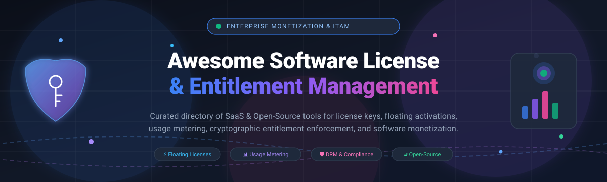

# 🔑 Awesome Software License & Entitlement Management 🛡️

  
  
  
  
  
  

  <strong>A definitive curated directory of top Software License and Entitlement Management platforms, software monetization engines, licensing APIs, and self-hosted open-source license servers.</strong>

  Enforce license terms ⚖️ • Manage dynamic user entitlements 🎫 • Power usage-based metering 📈 • Distribute signed software updates 📦

  🌟 <em>Star this repository if you find it valuable for your engineering or monetization stack!</em> 🌟

---

## 📑 Table of Contents

- [🌐 Sector Overview & Market Dynamics](#-sector-overview--market-dynamics)
- [🟦 SaaS / Hosted Platforms](#-saas--hosted-platforms)
- [🟩 Open-Source Software](#-open-source-software)
- [📊 Feature Comparison at a Glance](#-feature-comparison-at-a-glance)
- [📈 Star History](#-star-history)
- [💖 Support & Sponsorship](#-support--sponsorship)
- [🤝 Contributing](#-contributing)
- [📄 License](#-license)

---

## 🌐 Sector Overview & Market Dynamics

The global Software License Management (SLM) and Software Monetization market is valued at approximately **$3.3B to $4.3B** and is projected to expand at a Compound Annual Growth Rate (**CAGR**) of **13.5%–16.2%** to exceed **$15B** by the early 2030s.

The sector is **moderately to highly fragmented** rather than a "winner-take-all" monopoly: enterprise giants dominate legacy on-premise DRM and IT Asset Management (ITAM/SAM) compliance, while high-growth agile SaaS vendors and open-source frameworks thrive by catering to cloud-native, consumption-based metering, product-led growth (PLG), and developer-first licensing APIs.

---

## 🟦 SaaS / Hosted Platforms

Below is a comparison of leading commercial and cloud-hosted Software License and Entitlement Management platforms, **sorted descending by company size (annual revenue / valuation)**.

| 🏢 Platform | 💰 Company Size (Valuation / Revenue) | 🏷️ Starting Price | 🎁 Free Tier / Trial Limit | 🧩 Core Capabilities & Strengths |
| :--- | :--- | :--- | :--- | :--- |
| **[Thales Sentinel](https://cpl.thalesgroup.com/software-monetization)** 🛡️ | **~$54B Market Cap** *(Parent: Thales Group, €20.6B+ / ~$22B Rev)* | **Custom quote** *(Enterprise tier contracts)* | **30-day free trial** *(Includes Sentinel LDK / Cloud evaluation kit upon request)* | Enterprise-grade software monetization, versionless entitlements, hardware keys (dongles), floating tokens, and ERP integration (SAP, Salesforce). |
| **[Flexera One ITAM](https://www.flexera.com/products/flexera-one/itam)** 🏢 | **~$2.9B Valuation** *(Parent: Flexera / Thoma Bravo, $700M+ ARR)* | **Custom quote** *(Entry modules start at ~$50,000/yr via AWS Marketplace)* | **Interactive guided demo** *(Scoped proof-of-concept POC trial upon request)* | Comprehensive IT Asset Management (ITAM), SaaS shadow IT discovery, BYOL cloud license optimization, and audit compliance for Oracle/SAP/Microsoft. |
| **[Revenera FlexNet](https://www.revenera.com/)** ⚙️ | **~$2.9B Parent Valuation** *(Division of Flexera, $700M+ ARR)* | **Custom quote** *(Baseline implementations start at ~$10,000/yr)* | **Custom enterprise trial** *(Evaluation sandbox provided upon qualification)* | Industry standard for software vendors: FlexNet Operations & Licensing, SKU explosion prevention, product line-item auditing, and package lifecycle controls. |
| **[Snow Software](https://www.flexera.com/products/snow-software)** ❄️ | **$100M+ ARR** *(Acquired by Flexera / Thoma Bravo)* | **Custom quote** *(Tailored to endpoint/server estate volume)* | **Interactive live demo** *(Trial evaluation available through Flexera sales)* | Software Asset Management (SAM) with automated quarantine management, idle license reclamation, compliance risk calculation, and multi-cloud visibility. |
| **[Reprise License Manager (RLM)](https://www.reprisesoftware.com/)** 📜 | **~$10M–$25M Est.** *(Subsidiary of FOG Software / Constellation)* | **Custom quote** *(Priced by vendor revenue tiers of protected software)* | **Free evaluation license** *(Full-featured developer bundle available upon request)* | Transparent client-server licensing, published log formats, embedded license signatures (`rlmsign`), and RLM Activation Pro internet retrieval. |
| **[10Duke](https://www.10duke.com/)** 👤 | **~$2.1M ARR** *(Private, scale-up)* | **$199 / month** *(Single-tenant baseline)* | **30-day free trial** *(Full access to identity-based licensing engine)* | Identity-integrated licensing, federated SSO integration, fast entitlement provisioning, desktop and web license orchestration, and real-time analytics. |
| **[LicenseSpring](https://licensespring.com/)** 🌸 | **~$1.3M ARR** *(Private, bootstrapped)* | **$199 / month** *(Business Starter flat rate)* | **Free tier forever** *(Up to 1 product, 1 dev environment, 1,000 API requests/month; or 14-day trial)* | Native consumption-based licensing, quota decrementing, floating license server, and cross-platform SDKs (C++, C#/.NET, Python, Swift, Go). |
| **[Cryptlex](https://cryptlex.com/)** 🔐 | **~$300K–$1M ARR** *(Private, bootstrapped)* | **$100 / month** *(Starter tier flat rate)* | **Free tier forever** *(Up to 10 activations, 1 product, 1 admin; plus 30-day free trial for paid tiers)* | Node-locked and floating licenses with offline lease support, webhooks, reseller management, customer portal, and EU-hosted cloud data regions. |

---

## 🟩 Open-Source Software

Self-hosted, transparent, and community-driven license managers and entitlement servers, **sorted descending by GitHub Stars_Count**.

| 📦 Repository & Project | 🌟 GitHub_Stars | 💻 Tech Stack | 📜 License | 🎯 Highlights & Primary Use Case |
| :--- | :--- | :--- | :--- | :--- |
| **[Keygen API](https://github.com/keygen-sh/keygen-api)** 🔑 |  | Ruby / Rails / PostgreSQL / Redis | Fair Source / EE | High-scale, developer-centric licensing and software distribution engine. Supports cryptographic offline licensing, floating seats, and automated binary release updates. |
| **[Cedar License Manager](https://github.com/cedar-v/license-manager)** 🌲 |  | Go / Vue.js / SQLite | Apache-2.0 | Independent license generation, distribution, and validation system designed for IoT devices and enterprise software with hardware binding. |
| **[Keygate](https://github.com/tabloy/keygate)** 🚪 |  | Go / PostgreSQL / S3 | MIT | Modern, self-hosted alternative to Keygen and Cryptlex. Atomic usage metering, floating seats, Stripe billing synchronization, and Ed25519 signed auto-updates. |
| **[dnauck License.Manager](https://github.com/dnauck/License.Manager)** 🎛️ |  | C# / ServiceStack / AngularJS | MIT | Web-based management console for Portable.Licensing. Provides cryptographic key generation and validation for .NET desktop and server applications. |
| **[Laravel License Server](https://github.com/laravel-ready/license-server)** ⚡ |  | PHP / Laravel | MIT | Turnkey licensing server package for Laravel applications. Manage licenses, domain activations, and client device validation out of the box. |
| **[Software License Manager](https://github.com/Arsenal21/software-license-manager)** 🧩 |  | PHP / WordPress | GPL-2.0 | Proven license manager serving thousands of WordPress and PHP developers. Manage activations, expirations, and remote client verification via REST API. |
| **[PHP License Server](https://github.com/cubiclesoft/php-license-server)** 🐘 |  | PHP / CLI Server | MIT / LGPL | Lightweight, high-performance license server system service for tracking digital product keys, major version locks, and customer activations. |
| **[License Mate](https://github.com/yjpictures/license-mate)** 🧉 |  | Python / Flask / MongoDB / Docker | MIT | Docker-deployable REST API microservice providing simple software license generation, validation, and expiration management. |
| **[Labs64 NetLicensing Gateway](https://github.com/Labs64/NetLicensing-Gateway)** 🌐 |  | Java / Docker | Apache-2.0 | Automated e-commerce licensing gateway connecting NetLicensing with FastSpring, PrestaShop, MyCommerce, and SendOwl for automated license issuance. |

---

## 📊 Feature Comparison at a Glance

| 🛠️ Software Platform | ⚖️ Model / License | 💻 Primary Stack | 🔄 Floating / Concurrent | 📈 Usage Metering | 💳 Billing & Payment Sync | 🏠 Self-Hosted Available | 🎯 Primary Sweet Spot |
| :--- | :--- | :--- | :---: | :---: | :---: | :---: | :--- |
| **Thales Sentinel** | Commercial | Cloud / On-prem | ✅ | ✅ | ERP / CRM integrations | ✅ *(On-prem)* | Enterprise hybrid hardware/software monetization |
| **Flexera One ITAM** | Commercial | Cloud | *(ITAM)* | *(Cloud spend)* | ❌ | ❌ | Multi-cloud ITAM compliance & contract optimization |
| **Revenera FlexNet** | Commercial | Cloud / On-prem | ✅ | ✅ | ERP integrations | ✅ *(On-prem)* | Enterprise entitlement auditing & SKU management |
| **Snow Software** | Commercial | Cloud / On-prem | *(SAM)* | ✅ | ❌ | ❌ | Automated license reclamation & audit readiness |
| **Reprise (RLM)** | Commercial | Client-Server / C | ✅ | ✅ | ❌ | ✅ *(On-prem)* | ISV transparent client-server licensing |
| **10Duke** | Commercial | Cloud | ✅ | ✅ | Stripe / Payment APIs | ❌ | Identity-integrated licensing & enterprise SSO |
| **LicenseSpring** | Commercial | Cloud | ✅ | ✅ *(Consumption)* | Stripe / Webhooks | ❌ | Consumption-based pay-per-operation models |
| **Cryptlex** | Commercial | Cloud / Hybrid | ✅ *(Offline)* | ✅ | Stripe / Resellers | ✅ *(On-prem)* | Offline leases & floating seat activation |
| **Keygen API** | Fair Source / EE | Ruby / Postgres | ✅ | ✅ | Stripe native | ✅ | Developer-first licensing & auto-updating binaries |
| **Cedar License Mgr** | Apache-2.0 | Go / Vue | ✅ | ❌ | ❌ | ✅ | IoT device licensing with hardware ID binding |
| **Keygate** | MIT | Go / Postgres | ✅ | ✅ *(Atomic)* | Stripe native | ✅ | All-in-one self-hosted server with Stripe sync |
| **NetLicensing Gateway**| Apache-2.0 | Java / Docker | *(Backend)*| *(Backend)* | E-commerce Gateways | ✅ | E-commerce automated license fulfillment |

---

## 📈 Star History

---

## 💖 Support & Sponsorship

Thank you for visiting and supporting **Awesome Software License & Entitlement Management**! 

If this curated guide has saved you time, helped you evaluate platforms, or supported your project's monetization architecture, please consider showing your support:

- ⭐ **Star this repository** to help others discover it.
- 🍴 **Fork the repo** to contribute additions, fixes, or updates.
- 📢 **Share with colleagues, teammates, and developers** building software licensing or entitlement workflows.
- ☕ **Buy a coffee / Sponsor the project:** Support ongoing maintenance and curation on the [GitHub Sponsors Dashboard](https://github.com/sponsors/ishandutta2007).

  

---

## 🤝 Contributing

Contributions are warmly encouraged! If you know of an outstanding open-source license server or commercial entitlement platform that should be included:

1. 🍴 Fork the repository.
2. 🌿 Create your feature branch (`git checkout -b feature/cool-license-tool`).
3. ✍️ Add the project details adhering to the existing tabular format and criteria.
4. 🚀 Submit a Pull Request with a short summary describing why the tool stands out.

---

## 📄 License

This repository and curated list are released under the [CC0 1.0 Universal (Public Domain)](https://creativecommons.org/publicdomain/zero/1.0/) license. All product and company names are trademarks™ or registered® trademarks of their respective holders.
